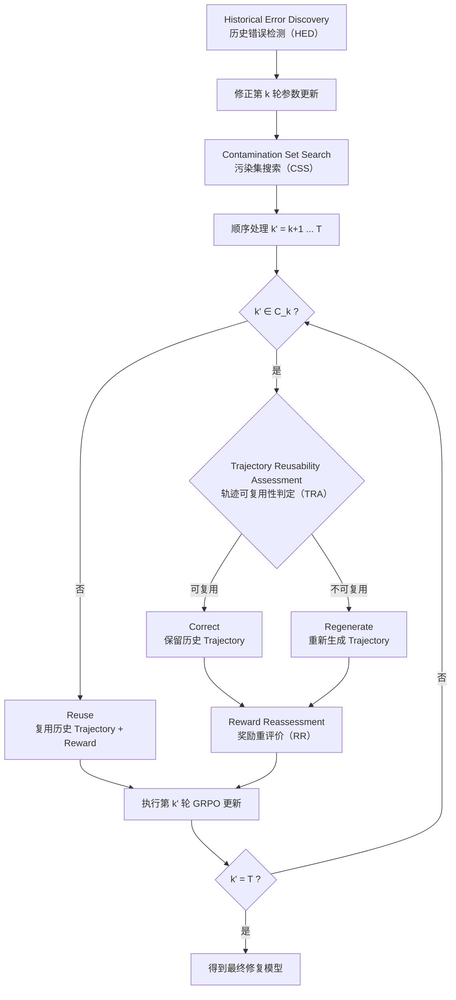

# SCOR：Selective Counterfactual Outer Repair

> **SCOR: Selective Counterfactual Outer Repair for Post-update Training-Path Contamination**

## 1. 问题定义

Agent0-VL 一类 self-evolving system 在每个 outer loop 中依次执行 Solver rollout、Verifier 评分和参数更新。记第 $t$ 轮训练状态为 $S_t$，训练数据为 $D_t$，Verifier 给出的 reward 为 $\hat r_t$：

$$
S_t\rightarrow D_t\rightarrow\hat r_t\rightarrow S_{t+1}
$$

Agent0-VL 的 inner-loop repair 发生在参数更新前。Solver 产生错误 trajectory 后，Verifier 检出错误，Solver 返回对应位置重新求解，Verifier 再评分。

SCOR 处理 reward 已进入参数以后才被发现的历史错误。设第 $k$ 轮产生错误 trajectory $\tau_k^{wrong}$，Verifier 同时误判，使 $\hat r_k\neq r_k^*$：

$$
S_{k+1}=U(S_k,D_k,\hat r_k)
$$

模型随后继续参与训练，错误影响可能通过自生成数据向后传播：

$$
\hat r_k
\rightarrow S_{k+1}^{corrupt}
\rightarrow D_{k+1}^{corrupt}
\rightarrow S_{k+2}^{corrupt}
\rightarrow\cdots
\rightarrow S_T^{corrupt}
$$

后续出现 ground truth、程序执行结果、确定性工具、更可靠的 Verifier、重复任务冲突、客观视觉证据或延迟人工标签时，系统才确认第 $k$ 轮存在错误。

本文将这种现象定义为 **Post-update Training-Path Contamination**：历史错误监督已经进入参数更新，并通过后续 self-generated training data 持续影响训练过程。

第 $k$ 轮错误包含两类影响。**Direct Contamination（当代污染）** 指 $\hat r_k$ 直接产生的参数偏移；**Descendant Contamination（后代污染）** 指这次参数变化继续改变后续 trajectory、tool call、reward 和训练数据：

$$
\delta\theta_k
\rightarrow\delta D_{k+1}
\rightarrow\delta\theta_{k+1}
\rightarrow\delta D_{k+2}
\rightarrow\cdots
$$

SCOR 主要处理 Descendant Contamination，目标是在历史错误被确认后，找到实际受到影响的训练单元，并以低于完整回滚的成本恢复接近正确训练历史的模型。

---

## 2. 四种修复方案

### Continue Training

发现历史错误后继续训练，不增加修复操作，最终状态记为 $S_T^{00}$。该方案用于测量后续训练能够自然覆盖多少历史污染。

### Direct Correction

修正第 $k$ 轮 reward，重新执行该轮 update；之后继续使用历史 $G_{k+1}^{hist},\ldots,G_T^{hist}$，依次重新训练到 $T$，得到 $S_T^{10}$。

该方案主要恢复 Direct Contamination。

### Full Rollback

恢复第 $k$ 轮之前的 checkpoint，修正监督，并重新执行之后全部 Solver rollout、Verifier 和参数更新：

$$
S_k\xrightarrow{r_k^*}S_{k+1}^{cf}
\rightarrow D_{k+1}^{cf}
\rightarrow\cdots
\rightarrow S_T^{cf}
$$

$S_T^{cf}$ 定义为 **Counterfactual Clean Oracle**，提供完整恢复结果，同时承担最高重算成本。

### SCOR

SCOR 从修正后的第 $k$ 轮继续按照 $k+1,\ldots,T$ 的原时间顺序训练。每个后续 outer loop 采用三种操作之一：

- **Reuse**：历史 training unit 仍有效，复用原 trajectory 和 reward；
- **Correct**：training unit 受到污染，但历史 trajectory 仍可使用，保留 trajectory 并重评价 reward；
- **Regenerate**：历史 trajectory 已脱离当前 repair policy 的合理行为范围，由当前模型重新 rollout，再评价新的 reward。

Full Rollback 相当于后续所有 outer loops 全部 Regenerate；SCOR 通过选择 Reuse、Correct、Regenerate 减少重算。

---

## 3. SCOR 总体流程

SCOR 保存：

$$
\mathcal H=\{S_t,G_t,\pi_t,V_t,E_t\}_{t=1}^{T}
$$

其中 $G_t$ 为进入参数更新前的最终 training group，$\pi_t$ 为 Solver policy，$V_t$ 为 Verifier，$E_t$ 保存验证证据。

SCOR 包含四个子算法：

1. **Historical Error Discovery（历史错误检测，HED）**：发现已经进入参数的历史错误。
2. **Contamination Set Search（污染集搜索，CSS）**：寻找第 $k$ 轮错误影响的后续训练单元，得到污染集 $C_k$。
3. **Trajectory Reusability Assessment（轨迹可复用性判定，TRA）**：判断 $C_k$ 中的历史 trajectory 能否继续使用。
4. **Reward Reassessment（奖励重评价，RR）**：重新确定最终采用 trajectory 的 reward。

---

## 4. Historical Error Discovery（HED）

HED 利用后续新增证据重新审计历史 training events。对于第 $k$ 轮，估计：

$$
P(\hat r_k\neq r_k^*\mid E_{k:T})
$$

历史记录较大时，按错误概率、潜在 downstream damage 和 audit cost 安排检查顺序：

$$
Priority_k=
\frac{
P(error_k\mid E)\cdot\widehat{Damage}_k
}{
Cost_{audit}(k)
}
$$

确认错误后输出 Revision Certificate，记录 $k$、原 reward、错误置信度和对应证据，再启动 repair。

---

## 5. 第 $k$ 轮 Direct Repair

确认第 $k$ 轮错误后，先修正该轮 reward。设：

$$
G_k=\{\tau_1,\ldots,\tau_n\}
$$

GRPO 的历史 advantage 为：

$$
A_i^{hist}
=
\frac{r_i^{hist}-\mu(r^{hist})}
{\sigma(r^{hist})}
$$

GRPO 使用 group-relative advantage，一个 reward 改变会同时改变 group 的均值、方差以及其他 trajectory 的 advantage，因此第 $k$ 轮需要重新计算整个 $G_k$ 并执行 update。

得到：

$$
S_{k+1}^{repair}
$$

作为后续修复分支起点。

---

## 6. Contamination Set Search（CSS）

定义污染集 $C_k$ 为第 $k$ 轮错误实际影响超过允许范围的后续 **outer-loop training units**：

$$
C_k=\{G_{k+2},G_{k+5},G_{k+9},\ldots\}
$$

$C_k$ 可以是非连续集合。SCOR 仍按完整时间顺序重新训练，$C_k$ 决定哪些 training unit 可以直接 Reuse。

CSS 关注历史数据是否产生了有意义的 update 偏差。设 repair branch 在第 $t$ 轮的参数为 $\theta_t^{repair}$，历史 group 为 $G_t^{hist}$，Full Rollback 对应 group 为 $G_t^{cf}$：

$$
\Delta_t^{reuse}
=
\left\|
g_t(\theta_t^{repair},G_t^{hist})
-
g_t(\theta_t^{repair},G_t^{cf})
\right\|
$$

再考虑该偏差传播到最终状态时的放大：

$$
I_{k\rightarrow t}
=
A_{t\rightarrow T}\Delta_t^{reuse}
$$

当 $I_{k\rightarrow t}>\tau_t$ 时，将 $G_t$ 纳入 $C_k$。

RL rollout 自身存在随机分叉，因此 CSS 使用独立 clean branches 测量 $B_t^{stoch}$：

$$
\tau_t=
\max
\left(
\tau_{task},
Q_{1-\alpha}(B_t^{stoch})
\right)
$$

以区分正常随机波动和错误引起的额外污染。

self-evolving training 中：

$$
\theta_{t+1}
=
\theta_t+
\eta_t
\mathbb E_{G\sim P_{\theta_t}}
[u_t(\theta_t,G)]
$$

参数变化同时改变 update 和下一轮 rollout distribution，形成：

$$
\delta\theta
\rightarrow
\delta P(G)
\rightarrow
\delta update
$$

CSS 需要估计这一 endogenous propagation。

完整生成所有 $G_t^{cf}$ 会使成本接近 Full Rollback，因此实际搜索先使用 likelihood ratio、ESS、policy KL、action/token disagreement、gradient alignment、task similarity 和 tool-call divergence 等低成本信号估计 historical group shift。这些信号只判断 training unit 是否受到污染，trajectory 本身能否沿用交给 TRA。

CSS 为每个 training unit 维护：

$$
I_{k\rightarrow t}\in[L_t,U_t]
$$

若 $U_t<\tau_t$，进入 Reuse；若 $L_t>\tau_t$，进入 $C_k$；区间跨越阈值时生成少量：

$$
G_t^{probe}\sim\pi_t^{repair}
$$

缩小不确定区间。

多个弱污染还可能累积，因此维护 Residual Contamination Budget：

$$
R_{res}
=
\sum_{t:a_t=Reuse}U_t
\leq\epsilon
$$

总体选择目标为：

$$
a_{k+1:T}^{*}
=
\arg\min
\sum_{t=k+1}^{T}Cost_t(a_t),
\qquad
\text{s.t. }
\sum_{t=k+1}^{T}Error_t(a_t)\leq\epsilon
$$

其中 $a_t\in\{Reuse,Correct,Regenerate\}$。

---

## 7. Trajectory Reusability Assessment（TRA）

对于 $G_t\in C_k$，TRA 判断历史 trajectory 是否仍属于当前 Repair Model 的正常行为范围。

Agent 多次 rollout 天然存在随机性，TRA 采用当前模型自己的随机行为分布进行校准，输出 **Reusable、Non-Reusable、Uncertain** 三种状态。

首先从历史 trajectory 中抽取 **Decision Anchors**，只保留真正影响后续状态的节点，包括 tool selection、tool arguments、关键 observation、环境状态变化、关键 action 和最终决策：

$$
A(\tau_t^{hist})
=
\{a_1^{hist},a_2^{hist},\ldots,a_m^{hist}\}
$$

不同 action 可能产生等价结果，因此定义：

$$
\phi(a,o,s')=c
$$

根据 action、observation 和执行后的状态，将行为映射到 **Behavior Effect Class**。TRA 比较行为效果，而非 reasoning 文本或 action 字符串。

对于第 $j$ 个 Decision Anchor，恢复历史状态 $s_j^{hist}$，让当前 repair policy 多次重新决策，估计：

$$
P_{\pi_t^{repair}}(c\mid s_j^{hist})
$$

并根据模型自身随机性构造 Behavior Support Set：

$$
\Gamma_j^{1-\alpha}
$$

若历史行为类别 $c_j^{hist}$ 位于该集合内，则该分支仍受到当前 policy 支持。

TRA 按 trajectory 顺序检查各 Decision Anchor。某个关键节点被判定为 Non-Reusable 后，后续历史 observation 已建立在失效分支上，检测在该处停止并进入 Regenerate；所有关键节点通过则进入 Correct。

边界样本通过 Active Trajectory Probe 增加重复决策次数：

$$
M_1<M_2<\cdots<M_q
$$

直到确认 Reusable、Non-Reusable，或达到 Probe Budget。达到预算后仍处于 Uncertain 的样本采用保守的 Regenerate。

GRPO 的训练单位是 group。TRA 可以产生 trajectory reuse mask，第一阶段采用 group-level 保守规则：group 中出现关键 Non-Reusable trajectory 时重新生成整个 group；后续再研究历史 trajectory 与 regenerated trajectory 混合组成的 partial-reuse group。

---

## 8. Reward Reassessment（RR）

TRA 决定最终采用历史 trajectory 或新 trajectory，RR 再确定对应 reward。

RR 优先使用 ground truth、executable checker、deterministic tool 和 objective environment feedback；缺少确定性证据时，再使用 repair branch Verifier、parameter-decoupled independent Verifier、Verifier ensemble、tool-assisted verification、forward/backward verification 和后续新增证据。当前可能受污染的 Verifier 仅作为辅助证据。

三种操作的 reward 处理分别为：

**Reuse**

$$
r_t^{Reuse}=r_t^{hist}
$$

历史 reward 连同 Agent0 原有的 inner-loop repair penalty 一起复用。

**Correct**

保留历史 trajectory，RR 重新确定任务得分 $s_t^{repair}$，历史 trajectory 已经发生过的 inner-loop repair cost 继续保留：

$$
r_t^{Correct}
=
s_t^{repair}
-
\lambda_{in}c_{in,t}^{hist}
$$

**Regenerate**

当前 Repair Model 重新产生 $\tau_t^{repair}$，RR 评价新的任务结果，inner-loop repair cost 根据新 rollout 重新计算：

$$
r_t^{Regenerate}
=
s_t^{repair}
-
\lambda_{in}c_{in,t}^{repair}
$$

SCOR 的 CSS、TRA、RR、Probe 和 Regenerate 开销记录为 outer repair cost：

$$
C_{SCOR}
=
C_{CSS}
+
C_{TRA}
+
C_{RR}
+
C_{Regenerate}
$$

该成本用于修复策略和实验评价，不直接进入 GRPO reward。

历史 repair 本身涉及监督修正，因此 RR 还记录 reward uncertainty：

$$
r_i^*\in[r_i^-,r_i^+]
$$

对应：

$$
A_i\in[A_i^-,A_i^+]
$$

若 $A_i^->0$，该 trajectory 在当前证据范围内保持正 advantage；若 $A_i^+<0$，保持负 advantage；区间跨越 $0$ 时继续获取验证证据。

---

## 9. Selective Repair Training

SCOR 从 $k+1$ 开始，按照原时间顺序重新训练到 $T$：

$$
\text{Reuse}:
(Trajectory^{hist},Reward^{hist})
\rightarrow GRPO
$$

$$
\text{Correct}:
(Trajectory^{hist},Reward^{repair})
\rightarrow GRPO
$$

$$
\text{Regenerate}:
(Trajectory^{repair},Reward^{repair})
\rightarrow GRPO
$$

所有 update 都基于当前 Repair Model 重新执行。

Agent0-VL 主实验保持 GRPO 不变，使 SCOR 与 optimizer change 分离；后续再比较 REINFORCE、PPO、GRPO 和 RLOO。

---

## 10. 当前阶段的验证性实验

这一阶段先确认 SCOR 依赖的现象是否存在，HED、CSS、TRA 和 RR 暂时使用 oracle 信息绕过。

### 实验一：历史错误是否长期保留

人工选择第 $k$ 轮，将正确 reward 改错并进入 GRPO。Clean branch 使用正确 reward，Corrupt branch 使用错误 reward，之后强制使用完全相同的训练数据。

训练到 $T$ 后比较 downstream performance、policy divergence、固定 probe set 行为和 repeated-error rate。

该实验检验单次错误 update 的影响能否被后续训练自然覆盖。

### 实验二：Descendant Contamination 是否存在

恢复真实 on-policy rollout，使 Clean 和 Corrupt branch 根据各自模型继续产生训练数据，同时运行两条不同随机种子的 clean branch 估计正常随机分叉 $D_{stochastic}$。

比较固定后续数据时的 $D_{fixed}$ 与真实 on-policy 条件下的 $D_{online}$。若 $D_{online}$ 明显高于 $D_{fixed}$，并超过 $D_{stochastic}$，说明错误参数通过 self-generated data 继续传播。

### 实验三：污染是否造成实际性能损失

实验二确认训练路径发生额外分叉后，在固定 held-out evaluation set 上持续测量：

$$
\Delta P_t
=
P_t^{clean}
-
P_t^{corrupt}
$$

同时记录 downstream accuracy / task score、repeated-error rate、tool/action failure rate 和固定 probe set 错误行为，并使用 clean-clean branch 给出正常性能波动范围。

若 Corrupt branch 出现稳定性能下降、重复错误增加或 tool/action failure 增加，则说明训练污染已经造成实际能力损失。

### 实验四：Direct Correction 是否足够

比较 Continue Training、Direct Correction 和 Full Rollback。

若 $S_T^{10}$ 已接近 $S_T^{cf}$，第 $k$ 轮 Direct Repair 已覆盖主要影响；若 Direct Correction 只能恢复部分结果，并与 Full Rollback 保持稳定差距，则后续污染构成独立修复对象。

### 实验五：污染是否具有稀疏或非连续结构

利用 Full Rollback 的 historical branch 和 clean branch，逐轮计算 oracle impact：

$$
I_{k\rightarrow t}^*
$$

得到 oracle contamination set：

$$
C_k^*
$$

统计：

$$
\frac{|C_k^*|}{T-k}
$$

以及污染强度和轮次分布。

当 $|C_k^*|$ 接近 $T-k$ 时，Full Rollback 接近必要成本；污染集中在少数轮次时，Selective Repair 具有计算空间。连续窗口结构对应 Adaptive Rollback Window 强 baseline，稀疏、非连续结构则更能体现 CSS 的作用。

### 实验六：Oracle-SCOR 是否逼近 Full Rollback

暂时假设 CSS、TRA、RR 完美，直接使用 Full Rollback 得到的 $C_k^*$ 和正确 counterfactual training group。

对于 $k'\notin C_k^*$ 使用历史数据，对于 $k'\in C_k^*$ 直接使用 Full Rollback 产生的正确数据，得到 $S_T^{Oracle-SCOR}$。

比较：

$$
S_T^{Oracle-SCOR}
\quad\text{与}\quad
S_T^{cf}
$$

并统计 Solver rollout、Verifier calls、tool calls、regenerated groups、GPU Hours 和总训练成本。

若 Oracle-SCOR 以明显较低成本达到接近 Full Rollback 的性能，则 selective repair 的基本假设成立；若 oracle 条件下仍缺少成本优势或恢复效果，CSS、TRA 和 RR 的继续开发缺少实验依据。

---

## 11. 正式主实验

六组验证实验通过后，用 HED、CSS、TRA、RR 替换 oracle。

主要 baseline 包括：

1. Continue Training；
2. Direct Correction；
3. Reward Relabel + Replay；
4. Historical Advantage Recompute；
5. Influence / Unlearning baseline；
6. Fixed-W Rollback；
7. Adaptive-W Rollback；
8. SCOR；
9. Full Rollback Oracle。

人工 corruption 控制 error position、reward error magnitude、corruption rate 和 detection delay；Natural reward revision 使用真实训练中能够由 ground truth、执行器或其他可靠证据确认的 Verifier mistakes。

主系统采用 Agent0-VL 类 self-evolving VLM。泛化实验加入至少一个 text reasoning self-evolving 或 self-training RL setting。

共享 Solver 和 Verifier 时，再设置 frozen Verifier、frozen Solver 和 parameter-decoupled Solver/Verifier，测量：

$$
Verifier\ Error
\rightarrow
Wrong\ Update
\rightarrow
Verifier\ Drift
\rightarrow
Future\ Reward\ Error
$$

这一反馈对 $|C_k|$、repeated-error rate 和 repair cost 的影响。

---

## 12. 评价指标

模型恢复以 Full Rollback 得到的 $S_T^{cf}$ 为参照，主要评价性能恢复、行为恢复和修复成本。

Counterfactual Performance Gap：

$$
Gap_{cf}
=
P_{oracle}-P_{repair}
$$

Normalized Recovery：

$$
Recovery=
\frac{
P_{repair}-P_{corrupt}
}{
P_{oracle}-P_{corrupt}
}
$$

Behavior Recovery 在固定 probe set 上比较 answer accuracy、policy divergence、action/tool-call distribution、repeated-error rate 和 tool/action failure rate。参数欧氏距离只作为辅助量。

Relative Repair Cost：

$$
RelativeCost
=
\frac{C_{repair}}
{C_{rollback}}
$$

统计 GPU Hours、FLOPs、Solver rollouts、Verifier calls、tool calls、regenerated groups、CSS probes 和 TRA probes。

Reconstruction Sparsity：

$$
RR_{sparse}
=
\frac{|C_k|}{T-k}
$$

CSS 以 $C_k^*$ 为 oracle，报告 Precision、Recall、F1、AUPRC、false-negative rate 和 impact-weighted recall：

$$
Recall_{impact}
=
\frac{
\sum_{t\in\hat C_k\cap C_k^*}I_{k\rightarrow t}^*
}{
\sum_{t\in C_k^*}I_{k\rightarrow t}^*
}
$$

同时统计 Residual Contamination。

HED 报告 detection recall、false revision rate、audit cost 和 detection delay。

TRA 报告 trajectory reuse precision、reuse recall、false-reuse rate、unnecessary regeneration rate、average probe cost 和 uncertainty rate，其中 false reuse 是主要风险指标。

RR 报告 reward reassessment accuracy、Certified Reward coverage、advantage-sign accuracy 和 second-order contamination rate。

最终使用 **Counterfactual Fidelity vs. Repair Cost** 绘制 Counterfactual Repair Frontier。

---

## 13. Optimizer 扩展

主实验固定 GRPO。随后在相同 $C_k$、trajectory decision、repair supervision 和训练预算下比较 REINFORCE、PPO、GRPO 和 RLOO，观察不同 updater 对 $Gap_{cf}$、Repair Cost 和 collateral damage 的影响。

---

## 14. Research Questions

### RQ1
历史 reward error 进入参数后，Continue Training 能够自然消除多少 Direct Contamination？

### RQ2
历史错误是否通过 endogenous self-generated data 产生 Descendant Contamination？

### RQ3
Descendant Contamination 是否造成稳定的 downstream performance degradation、repeated-error increase 或 tool/action failure？

### RQ4
Direct Correction 与 Full Rollback 之间是否存在稳定恢复差距？

### RQ5
HED 能否利用 Delayed Evidence，在有限 audit budget 下发现已经进入参数的历史 reward error？

### RQ6
Descendant Contamination 在后续 outer loops 中呈现怎样的规模、强度和连续性结构？

### RQ7
CSS 能否准确恢复污染集 $C_k$？

### RQ8
Uncertainty-aware Search 和 Active Contamination Probe 能否减少 CSS 所需的新 rollout？

### RQ9
Residual Contamination Budget 能否控制多个弱污染累积产生的最终影响？

### RQ10
TRA 能否在 Agent 存在随机决策和多条合理行为路径时，稳定判断历史 trajectory 是否仍可沿用？

### RQ11
Decision Anchors、Behavior Effect Class、Self-Calibrated Branch Support 和 Active Trajectory Probe 能否降低 TRA 的 false reuse 和 unnecessary regeneration？

### RQ12
RR 能否得到稳定的 $Reward^{repair}$，并降低 repair 阶段再次写入错误监督的风险？

### RQ13
SCOR 能否以明显低于 Full Rollback 的计算成本逼近 Counterfactual Clean Oracle？

### RQ14
SCOR 在 REINFORCE、PPO、GRPO 和 RLOO 下是否保持相同的基本修复规律？

---

## 15. 与相关方向的区别

Agent0-VL 的 inner-loop repair 处理参数更新前已经发现的 trajectory error；SCOR 处理错误 reward 已进入参数，并继续影响后续训练以后才被确认的历史错误。

Reward relabel、replay 和 late-reward correction 主要修改已有历史监督。SCOR 进一步处理：

$$
D_{t+1}=D(\pi_t)
$$

带来的后续 training-data shift。

Retrospective update correction 关注单次历史 update；SCOR 继续追踪该 update 对后续 self-generated training path 的影响。

Machine unlearning 主要处理已有训练数据的删除和修改；SCOR 还要判断参数变化引起的后续 trajectory 应采用 Reuse、Correct 还是 Regenerate。

Influence、trajectory influence 和 data valuation 可以作为 CSS 的影响估计工具。CSS 的目标是从已确认的历史错误出发，恢复其实际影响的训练单元集合 $C_k$。

TRA 与 trajectory similarity 或简单 off-policy likelihood 判断不同，它利用 Decision Anchors、Behavior Effect Class 和当前 Repair Model 自身的随机行为分布，判断历史 trajectory 是否仍位于当前 policy 的正常行为支持范围。

Verifier 和 reward-model 方法可以用于 RR。RR 只负责最终采用 trajectory 的 reward，trajectory 是否保留由 TRA 决定。

---

## 16. 主要贡献

**Post-update Training-Path Contamination** 定义历史 reward error 进入参数，并通过 self-generated data 向后传播的训练污染问题，同时区分 Direct Contamination 与 Descendant Contamination。

**Historical Error Discovery（HED）** 利用 Delayed Evidence、错误概率、潜在 downstream damage 和 audit cost 寻找已经进入参数的历史错误。

**Contamination Set Search（CSS）** 结合 Counterfactual Update Discrepancy、Future Amplification、Stochastic Floor、endogenous data propagation、uncertainty-aware search、active contamination probe 和 residual contamination budget，搜索非连续污染集 $C_k$。

**Trajectory Reusability Assessment（TRA）** 使用 Decision Anchors、Behavior Effect Class、Self-Calibrated Branch Support、Sequential Reusability Assessment 和 Active Trajectory Probe，在 Agent 随机分叉条件下判断历史 trajectory 是否仍可复用。

**Reward Reassessment（RR）** 根据 ground truth、执行器、确定性工具、Verifier 和其他新增证据重新评价 reward，并用 Certified Reward / Advantage 表达修复监督的不确定性。

**SCOR** 按完整时间顺序重新推进训练，在每个历史 outer loop 中选择 Reuse、Correct 或 Regenerate，以较低的重新 rollout、重新验证和重新训练成本逼近 Counterfactual Clean Oracle：

$$
\min C_{repair},
\qquad
\text{s.t. }
D(S_T^{SCOR},S_T^{cf})\leq\epsilon
$$

当前阶段先完成六组验证性实验，依次确认历史错误的持续性、Descendant Contamination、实际性能损失、Direct Correction 的局限、$C_k$ 的稀疏结构以及 Oracle-SCOR 的可行性，再进入 HED、CSS、TRA 和 RR 的正式开发。
