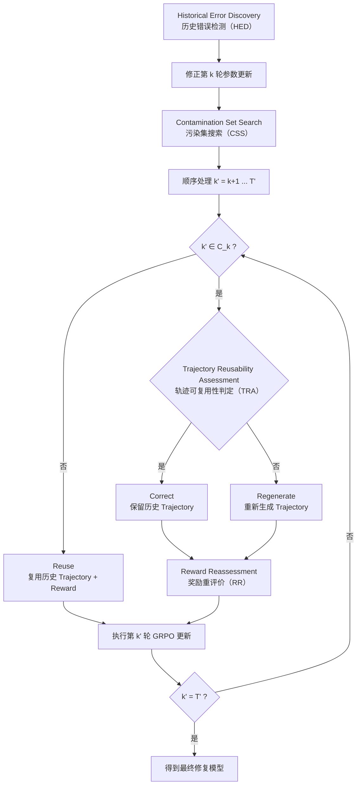

# SCOR: 对于Agent0-VL外循环的参数污染问题的选择性修复策略
### 问题定义
后发现的训练路径污染(Post-update Training-Path Contamination):
现在的agent0-vl的内循环中有一个repair机制: 当Verifier产出Reward时,发现Solver的策略错误,此时将会返回Solver从错误的地方重新解题,产出新的Trajectory,之后的外循环还会针对repair的情形产生负奖励.
问题在于,agent0-vl的repair机制是内循环的: 当Verifier也产出了错误的Reward, 进入外循环后,$(Trajectory,Reward)$两个参数最终被训练进模型参数,甚至其影响还很难评估.
因此需要提出一种存在于外循环之间的模型参数修复机制.

### 假设
假设: Solver在内循环第k轮产出了错误的Trajectory,且Verifier也产出了错误的Reward.这份错误在外循环中进入参数训练.
第k轮错误参数带来的污染有两种可能:
- 当代污染: 仅第k轮错误参数本身带来的影响
- 后代污染(**核心问题**): 第k轮错误参数以及之后以此参数训练带来的后续参数影响
### 解决方案
##### 三种去污染方案
在此基础上提出三种去污染假设:
1. 继续训练(Continue Training): 什么都不修,直接继续训练,新参数能够修正旧参数带来的错误影响.
	作为**baseline**,对照2和3的效果.
2. 当代修复(Directed Correction): 只修第k轮,后续全都使用原来的训练数据进行重训练.
3. 回滚(Full Rollback): 回到错误发生之前,放弃第k次之后的所有训练数据,从内循环开始重新训练此节点之后模型(最纯净,但也最昂贵).
4. 选择性外修复(Selective Counterfactual Outer Repair , SCOR)(**主要方法**): 将过去的Trajectory的错误Reward重新评价, 利用修正后的数据纠正第k轮模型参数.原本正确的Reward的训练数据保留.
	就像agent0提出的reward里面最终分数计算了repair的成本一样,我们不可能在外循环repair中将这种产生了错误reward的参数给忽略掉,应将其作为"成本".
三种方案的效率应该从"训练成本,纠正后效果,纠正性价比"这些角度综合评价.

##### SCOR算法
去污染算法基于4展开. 首先提出一个"污染集(Contamination Set)"$C_k$,指代的是第k轮产出真正影响到的**外循环训练单元**.
算法主要过程是一个强化学习框架: 
1. 在后续的循环中,发现了第k轮的Trajectory/Reward产出错误,并发现其已经进入VLM参数.
2. 在第k轮至今的所有**外循环**中,筛选出受到第k轮参数污染的轮次,形成污染集$C_k$.
3. 按顺序选取$k'>k$,找到$k'$对应的外循环在进入GRPO训练前,内循环最终的$(Trajectory_{k'},Reward_{k'})$.
4. 如果$k'\notin C_k$,则直接利用原本的$(Trajectory_{k'},Reward_{k'})$对第$k'$轮的模型参数进行GRPO训练 (Reuse);
5. 如果$k'\in C_k$:
	- 如果旧的$Trajectory_{k'}$能用,则以$Trajectory_{k'}$经过Verifier重评价,得到修正后的$Reward_{k'}^{repair}$.将$(Trajectory_{k'},Reward_{k'}^{repair})$经过GRPO重新训练进第$k'$轮的模型参数 (Correct).
	- 如果旧的$Trajectory_{k'}$都不能用(模型行为都已经改变),则需要Solver重新生成$Trajectory_{k'}^{repair}$,再由Verifier重评价,生成$Reward_{k'}^{repair}$,最后将完全重生成的$(Trajectory_{k'}^{repair},Reward_{k'}^{repair})$经过GRPO重新训练进第$k'$轮的模型参数 (Regenerate).
6. 以新的模型参数重复第3步,如此循环直至最新轮次(假设为第$T'$轮).
Full Rollback方案相当于完全采用步骤5的第二条,而SCOR方案则有选择性的采用 Reuse/Correct/Regenerate 三种策略的一种,有效控制了重训练成本.

### 子算法
整个算法中有几个核心问题:
- 是如何在第k轮后续的轮次中发现前面第k轮有错误的?
- 如何找到污染集$C_k$?也就是说,如何评判某一轮是否受到第k轮的影响? 通过Solver行为和决策来评判,如果差的多,就进入污染集."差得多"如何评判?
- 如何判定旧Trajectory能否使用?并且,agent的决策很多时候是不稳定的,如何保证这份评价的稳定性?
- 重评价算法如何设计?是直接重新经过Verifier评价,还是造一套新的?
于是分别引入了4个子算法:
- 历史错误检测(Historical Error Discovery, HED): 发现前面的轮次参数错误
- **污染集搜索**(Contamination Set Search, CSS): 寻找$C_k$
	- 需要精读: A Snapshot of Influence: A Local Data Attribution Framework for Online Reinforcement Learning，NeurIPS 2025
- **轨迹可复用性判定**(Trajectory Reusability Assessment, TRA): 判定$Trajectory_{k'}$能否沿用
- 奖励重评价(Reward Reassessment, RR): 重评价,得到$Reward_{k'}^{repair}$
由于四个创新算法太多, Killer Gate 阶段可以直接用 Oracle：
- HED：人工指定第 $k$ 轮错误。
- CSS：通过 counterfactual experiment 得到 Oracle $C_k^*$。
- TRA：通过 clean counterfactual branch 判断历史 trajectory 是否仍有效。
- RR：使用 ground truth / executable checker。

### 实验
##### 验证性实验
1. 验证错误参数是否会在后续训练中消失(确认idea的必要性)
2. 验证错误是否会继续污染后面的实验(验证后代遗传的存在性)
3. 验证错误参数是否会导致模型的正确率出现问题(验证修复后代遗传的必要性)
4. 比较 `Continue Training / Direct Correction / Full Rollback`(对比其他方案, 验证SCOR的必要性)(同时,对比解决当代污染,验证解决后代污染的必要性)
5. 查看$C_k$的比例,看被判定为污染的轮次的比例(对比Full Rollback, 验证后代污染的选择性, 验证使用SCOR的必要性)
6. 假设已知了子算法的决策(用Oracle替换SCOR部分步骤),跑一次.(对比Full Rollback, 查看SCOR的实际效果)
实验都成功 => SCOR idea 成立

##### 扩展实验
可以通过实验筛选出一个纠正受污染参数的RL optimizer而不一定要使用GRPO,其目的是: *用更少的纠正成本,恢复尽可能多的纯净参数*.常用的参数更新方法有Reinforce,PRO,GRPO,RLOO等.
"用更少的纠正成本,恢复尽可能多的纯净参数",纠正成本和纯净参数比例如何评判?

### 视觉 | 自进化 | Agent
Agent：
$$
Image + Question
\rightarrow Solver
\rightarrow Tool
\rightarrow Observation
\rightarrow Reasoning
\rightarrow Verifier
\rightarrow Repair
$$
这是一个真正的 agent workflow。
自进化：
$$
Trajectory
\rightarrow Reward
\rightarrow GRPO
\rightarrow\theta_{t+1}
\rightarrow New\ Trajectory
$$
模型产生经验，再通过 RL 修改自己的参数。这才是 self-evolving。
视觉：
$$
Image
\rightarrow VLM
\rightarrow Visual\ Reasoning
$$
以及：
$$
Visual\ Evidence
\rightarrow Verifier
$$
也就是说，视觉主要规定了经验是什么模态、错误可能发生在哪里、Verifier 要验证什么。

### ISSUEs

